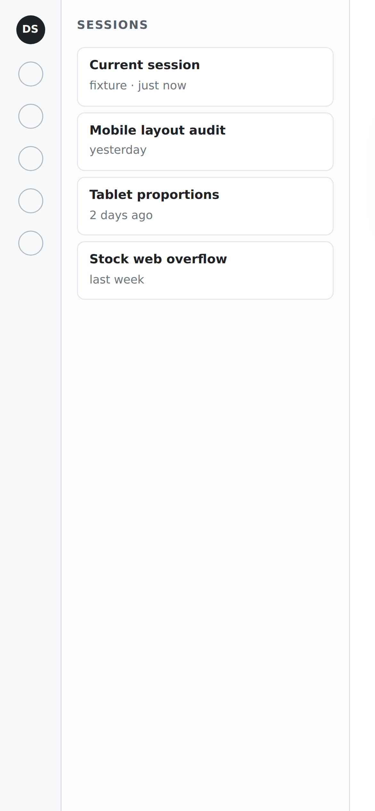
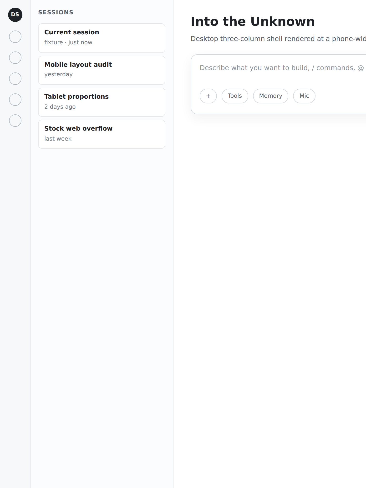

# dsh-ui-lab

**为 DSH 而生的 UI 验证工具。** 把同一份 DeepSeek Harness 界面铺到一整面真实设备比例上，一眼看出它从哪一档开始坏——在 Linux / Windows 上跑，不用拿起手机。

一个 DSH 界面得同时扛住 360px 的安卓机、430px 的 iPhone、768px 的平板，以及中间所有档位。逐个手验又慢又不可复现。`dsh-ui-lab` 为每一种比例配好真实的 CSS 视口、设备像素比、触摸标志与 UA，加载真正的 DSH surface，输出截图与布局度量；一次跑一整组比例，还能生成矩阵报告——于是 UI 改动可以**对比**，而不是靠**眼估**。

它是度量仪器，不是生产测试套件：把它指向跑在本机或你自己局域网里的 DSH 实例即可。

> 早期开发中。CLI 与 JSON 结构已可用，1.0 前仍可能有小幅调整。

## 比例

这是这个工具的正题。当前内置十种比例，每一种都有自己的视口、DPR、触摸标志与 UA：

| 类别 | 机型 |
| --- | --- |
| 手机（6） | `360×800` 安卓 · `375×667` iPhone SE · `390×844` iPhone 13/14/15 · `393×852` iPhone 15 Pro · `412×915` Pixel 7 · `430×932` iPhone 15 Pro Max |
| 平板（4） | `768×1024` iPad mini · `800×1280` Galaxy Tab · `820×1180` iPad Air 11 · `834×1194` iPad Pro 11 |
| 折叠屏 | **尚未提供** —— 类别已预留，不编造尺寸 |

要加自己的比例，改 [`profiles/profiles.json`](profiles/profiles.json) 即可；schema、UA 来源与读取器 API 见 [`docs/profiles.md`](docs/profiles.md)。折叠屏是下一个里程碑：展开后的内屏和笔记本/平板不是同一个问题（姿态、铰链、分屏），值得单独处理，而不是先填一个猜出来的视口。


## 测的是面板，不是欢迎页

真正要看的界面大多藏在侧栏某个入口后面 —— 那是插件自己的面板。`--open` 先点开那一行，再测量与截图：

```bash
dsh-ui-lab shot   --surface mobile --profile phone-390x844 --open Todos
dsh-ui-lab matrix --surface mobile --class tablet --open Todos --out .shots/todos
```

开启后结果里还会带上**面板盒**（宽、left…right、返回栏是否渲染）与**面板内的触控目标**
（多少个、最小多大、几个小于 44px）。这些列会进 `report.html` 与 `summary.json`，
于是「这个面板在哪一档比例上坏」可以由矩阵直接回答。

抽屉收起时会挡住行；工具会先像人一样把它展开，标签仍然匹配不上时**列出真实存在的标签**，而不是静默失败。

## 两种 surface

DSH 面向手机尺寸的屏幕有两种不同的东西，`dsh-ui-lab` 都能打开：

| | `dsh-mobile` | stock DSH web |
| --- | --- | --- |
| 是什么 | dsh-mobile 网关提供的专用移动页 | 手机/平板宽度下的 stock DSH web UI |
| 认证 | 一次性设备配对，缓存在 `.cache/` | DSH web 启动 token |
| 验证什么 | 真实移动端 boot graph、`.dshm-shell`、`mobile-layout.js`、扩展运行时 | 桌面壳被压窄后的表现：重排、溢出、点击热区、抽屉 |
| 重点暴露 | 专用页是否挂载 | 横向溢出——**取决于 build 与入口**（960px fixture：390 下 961/960；一个真实 stock 实例：390/390） |
| 命令 | `--surface mobile` | `--surface web`（默认） |

横向溢出**取决于 build 与入口**，不是 DSH 的通用事实。本地 960px fixture 在 390 视口下是 `scrollWidth 961` / `body.clientWidth 960`；一个真实 stock DSH web 实例（同一 `--profile web`、另一端口）在同宽度实测 390/390、`overflowX: false`。工具报告实际值——按数字判断，不要预设。原理见 [`docs/surfaces.md`](docs/surfaces.md)。

## 环境要求

- **Linux 或 Windows**（macOS 预期可用，但未纳入 CI）。
- Node.js >= 20。
- Playwright 及其 Chromium（`npx playwright install chromium`；Debian/Ubuntu 裸机可加 `--with-deps` 一并安装 Chromium 需要的系统库）。
- 一个 DSH 实例：
  - stock web：DSH web UI，默认 `http://127.0.0.1:3080`。DSH 用 per-process 启动 token 保护它，见[认证](#认证)。
  - dsh-mobile：桌面端开启 **移动访问 → 局域网**；网关地址由 admin status API 发现。

### Windows 说明

Windows 上不需要任何 Linux 专属依赖：Playwright 的 Windows Chromium 自带运行时，`npx playwright install chromium` 即可。

- Playwright 解析顺序与 Linux 相同：`--playwright` / `DSH_UI_LAB_PLAYWRIGHT` → 本包的 `node_modules` → `$DSH_HOME\profiles\web` → `$DSH_HOME\profiles\desktop`。DSH 桌面安装通常已自带，无需另装。
- `DSH_UI_LAB_WEB_TOKEN_FILE`：`mode 600` 检查只属于 POSIX，Windows 上会跳过（改用 ACL）。token 文件放用户目录下（如 `%USERPROFILE%\.dsh\web-token`），按密钥对待，不需要 `chmod`。
- 路径用 Windows 原生写法；PowerShell 中含空格的路径要加引号，例如 `--out "$env:USERPROFILE\dsh-shots"`。相对路径在所有平台上都相对当前目录解析。
- `npm test` 与 `npm run lint` 直接可用；没有安装 Chromium 时浏览器用例会自动跳过。

## 安装

> `dsh-ui-lab` 尚未发布到 npm registry。首个版本发布前请从源码目录或 `npm pack`
> 产物安装；下面的全局/npx 命令是预期用法。

```bash
npm install -g dsh-ui-lab
npx playwright install chromium
```

全局安装**不会**自动装上可选的 Playwright peer。可以让 CLI 复用
`$DSH_HOME/profiles/web` 自带的 Playwright（DSH 机器上通常如此），或者把它装在 CLI 旁边：

```bash
npm install -g playwright
npx playwright install chromium
# 通常全局 CLI 能直接解析到同级包；若不能：
export DSH_UI_LAB_PLAYWRIGHT="$(npm root -g)/playwright"
```

两种全局配法见 [Troubleshooting](docs/troubleshooting.md#playwright-or-chromium-is-missing)。

不全局安装：

```bash
npx dsh-ui-lab list
npx playwright install chromium   # 只需一次
```

从源码目录：

```bash
npm ci
npx playwright install chromium
npm link          # 把 `dsh-ui-lab` 放进 PATH
```

Playwright 是可选 peer 依赖：`list`、`--help` 与单测不需要它，截图命令需要。

## 快速开始

```bash
# 1. 看机型
dsh-ui-lab list
dsh-ui-lab list --class phone --json

# 2. 截一个机型（默认 surface 是 stock web）
dsh-ui-lab shot --surface web --profile phone-390x844 --out .shots --json

# 3. 截 dsh-mobile 专用页（首次配对，之后复用设备）
dsh-ui-lab shot --surface mobile --profile phone-390x844 --out .shots/mobile

# 4. 跑矩阵并打开报告
dsh-ui-lab matrix --surface web --class phone --out .shots/web-phone
# → .shots/web-phone/report.html + summary.json
```

`--profile` 支持模糊名：`--profile iphone` 会报告歧义并列出候选，`--profile "iphone se"` 解析到 `phone-375x667`。

stock web 示例假设 DSH web token 已就绪（见[认证](#认证)）；要打开专用页用 `--surface mobile`，或者用下面的本地 fixture 完全脱离 DSH 试跑。

矩阵也可以按 id 或分类收窄：

```bash
dsh-ui-lab matrix --surface mobile \
  --profiles phone-390x844,tablet-768x1024 \
  --out .shots/mobile-matrix --fresh
```

只测量、不写截图：

```bash
dsh-ui-lab measure --surface web --profile phone-390x844 --json
```

常用参数：

| 参数 | 作用 |
| --- | --- |
| `--fresh` | 丢弃缓存的移动端配对，重新配对 |
| `--wait <ms>` | 加载后额外等待时间（默认 2000） |
| `--inject <path>` | 截图前注入 CSS 文件或 dsh-mobile pack 目录 |
| `--open <label>` | 点开标签匹配的侧栏行（例如某个插件入口），截它自己的面板而不是欢迎页 |
| `--admin-url <url>` | DSH 不在默认 loopback 端口时的移动配对 admin 地址 |
| `--playwright <module>` | 指定 Playwright 安装位置 |

### 没有 DSH 也能试

仓库自带一个复刻桌面壳的本地 fixture，web surface 可以完全不连服务器、不需要凭据地端到端跑通：

```bash
dsh-ui-lab shot --surface web --profile phone-390x844 \
  --url "file://$PWD/test/fixtures/desktop.html" --out .shots/fixture --json
```

手机与平板宽度都会报 `overflowX: true`。浏览器测试（`npm test`）会用 `node:http` 提供同一个 fixture。

## 基线：这一档比例到底动没动

矩阵回答"现在长什么样"，基线回答"**跟上次比动了没有**"。存一次可信的运行，之后每次跑都对着它比——
比较是**逐像素计数**（带容差），所以一条抗锯齿边缘不会把每次都判成红的：

```bash
# 1. 存基线（在你认可的那次运行上做一次）
dsh-ui-lab matrix --surface mobile --class phone --open Todos \
  --out .shots/run --save-baseline .baselines/todos

# 2. 之后每次对比，让退出码决定红绿
dsh-ui-lab matrix --surface mobile --class phone --open Todos \
  --out .shots/run --baseline .baselines/todos
# 退出 0 = 在阈值内一致；退出 1 = 有变化或缺参考图
```

| 参数 | 作用 |
| --- | --- |
| `--baseline <dir>` | 与 `<dir>/<surface>__<profile>.png` 逐个比较；有变化或缺参考图时退出 1 |
| `--save-baseline <dir>` | 把本次截图存为基线并写 `baseline.json`（单张 `shot` 也支持） |
| `--diff-threshold <pct>` | 判定为"变化"的像素占比，默认 **1%** |

默认阈值不是 0，是有意的：活的 DSH 页面本来就有动的东西——相对时间（"1 h ago"）、闪烁光标、
加载指示器。390×844@3x 的图上那是几千像素（约 0.1–0.6%）。带时钟的页面把阈值调高，
想抓微小位移就调低（`--diff-threshold 0.1`）。

### 放进 CI

```yaml
- run: npx dsh-ui-lab matrix --surface mobile --class phone --open Todos --out .shots --baseline .baselines/todos
```

非零退出即失败。**只有在看过差异之后**才用 `--save-baseline` 重存基线 —— 这道闸门就是这个意思。

## 认证

新浏览器没有 DSH web cookie，`http://127.0.0.1:3080/` 会返回 `401 dsh web authentication required`。`dsh web` 启动时会打印一个带一次性、per-process 启动 token 的根 URL。把 token 交给工具的方式（优先级从高到低）：

1. 把带 token 的 URL 作为 `--url`；
2. 导出 `DSH_UI_LAB_WEB_TOKEN`；
3. 把 token 单独放进 mode `600` 的文件（POSIX 语义；Windows 上跳过 mode 检查、以 ACL 为准），用 `DSH_UI_LAB_WEB_TOKEN_FILE` 指向它。

工具用 token 换到签名 cookie 后继续访问干净 URL。token、CSRF cookie 与 storage state 不会出现在输出、报告或截图文件名里。`dsh-mobile` surface 不用这个 token，它走设备配对。

## 截图

下面的示例由仓库 fixture（`test/fixtures/desktop.html`）生成，不包含任何操作者的会话数据。两张都是 `--surface web`；桌面壳比视口宽，因此主栏被裁切——这正是要暴露的溢出。

| `phone-390x844` · 390×844 @3× | `tablet-768x1024` · 768×1024 @2× |
| --- | --- |
|  |  |

真实 `dsh-mobile` 截图会包含会话标题与账号头像，因此只在本地生成到 `.shots/`（已 gitignore），不入库。重新生成的命令见 [`docs/assets/README.md`](docs/assets/README.md)。

## 输出与度量

每次截图：

- `<out>/<surface>__<profile>.png` —— 按机型视口与 DPR 的截图（`measure` 不写 PNG）；
- stdout —— 人类可读摘要，或 `--json` 的机器可读结果。

JSON 结果包含：

```text
profile      { id, label, category }
surface      "web" | "mobile"
url          已清洗 URL（查询参数中的凭据已移除）
metrics      viewport, layoutViewport, visualViewport, devicePixelRatio, title,
             documentElement { clientWidth, scrollWidth, clientHeight, scrollHeight },
             body { clientWidth, scrollWidth },
             overflowX, shell, dedicatedMobileFrontend
screenshot   绝对路径或 null
injection    注入的 CSS/pack 元数据或 null
consoleErrors  已清洗的 console/page 错误
durationMs   截图墙钟耗时
```

`metrics.viewport` 是模拟的 CSS 视口（390×844），`layoutViewport` 是 `window.innerWidth` 报告的值；移动模拟下溢出的页面会把后者放大，所以设备宽度看 `viewport` / `visualViewport`。

矩阵还会写：

- `<out>/report.html` —— 自包含，内联 CSS，缩略图按本地文件名引用，无外链；
- `<out>/summary.json` —— 每个机型一行：id、label、viewport、DPR、`scrollWidth`、`body.clientWidth`、`overflowX`、`shell`、耗时、状态、截图文件名与已清洗错误。

## 退出码

| 码 | 含义 |
| --- | --- |
| `0` | 成功（矩阵：没有失败行） |
| `1` | 运行/截图失败（导航、配对、认证、浏览器、矩阵有失败行） |
| `2` | 用法错误（未知命令/参数、非法值、缺失或歧义 profile） |

矩阵中单个机型失败不会中断，会逐条报告、照常写报告；只要有失败行就以 `1` 退出。

## 已知限制

以下属于环境属性，不是可以报的 bug：

- **安全区为 0。** Chromium 里 `env(safe-area-inset-*)` 解析为 `0px`，刘海、圆角、Home Indicator 都验不了。
- **没有 WebView。** Android System WebView 与 iOS WKWebView 在 UA、CSS 支持、缓存和视口行为上与 Chromium 有差异；这里能跑通，不等于 App 内 WebView 也稳。
- **没有真机手感。** 拇指可达范围、点击热区舒适度、惯性滚动、双指缩放、触感、软键盘交互都不在范围内；`visualViewport` 不会像真机键盘那样收缩。
- **dsh-mobile 0.8.0 未测。** 工具在已安装的 dsh-mobile **0.7.1** 上验证；0.8.0 已发布但尚未实测。
- **TLS 不在验证范围。** dsh-mobile 网关使用自签证书，harness 有意忽略证书错误。
- **折叠屏未做。** `category: "foldable"` 仅预留，0 条数据，不编造尺寸；见 [`docs/profiles.md`](docs/profiles.md#foldables-not-done)。
- **单页面、单视口。** 多端同步、旋转中途、多窗口形态均不模拟。
- **stock DSH web 需要启动 token。** 裸 `:3080` 按设计返回 401，需按上文提供 token。

## 文档

- [Surfaces](docs/surfaces.md) —— 网关发现、配对、token、溢出。
- [Profiles](docs/profiles.md) —— 机型表、读取 API、如何新增。
- [Troubleshooting](docs/troubleshooting.md) —— 认证、配对、溢出、TLS、Playwright。
- [Contributing](CONTRIBUTING.md) —— 环境、测试、提交规范、凭据。
- [Changelog](CHANGELOG.md)。

## 许可证

MIT © 2026 LUgABeEEE。见 [LICENSE](LICENSE)。
